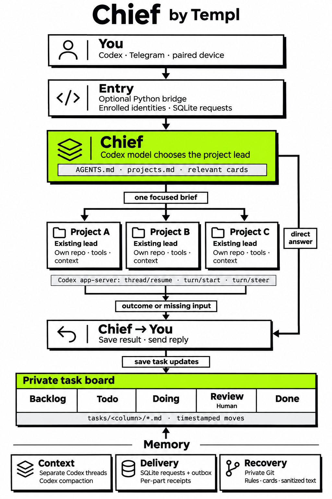

# Chief

Your AI chief of staff, made by [Templ](https://usetempl.com).

Coordinate your existing AI leads across projects and track their work on one private board.

## 🚀 Get started

Open your signed-in **Codex** and paste:

> Read https://raw.githubusercontent.com/usetempl/chief/main/docs/start.md and set up Chief for me.

Codex helps you set up Chief, pick a nickname and build your first board. Start with a signed-in Codex and workspace access. Telegram is optional.

## ⚙️ How it works

The core is Markdown instructions and records. The model makes decisions; Chief adds no planning engine, vector database or model server.

| Layer | What runs |
| --- | --- |
| **Coordinator** | One Codex thread reads instructions, `projects.md` and relevant cards, then answers or chooses an existing lead. |
| **Project leads** | Each project keeps its thread, repository and tools. Chief sends a focused brief; the lead returns a result or blocker. |
| **Board** | `tasks/<column>/*.md`: **Backlog** = ideas; **Todo** = committed work; **Doing** = execution; **Review** = human decision; **Done** = verified outcome. Moves retain timestamps. |
| **Memory** | Codex handles context and compaction. Markdown keeps durable facts; project owners keep detailed evidence. Private Git backups are optional. No wholesale history loading. |
| **Telegram · optional** | Python 3.12+, its standard library and pinned `websockets` connect to Codex's app-server. Enrollment controls access; SQLite holds requests, the outbox and delivery receipts. |
| **Reports & replies** | `/report` reads saved cards without model calls. `markdown-it-py` parses reply formatting into Telegram entities; numbered parts retain their styles and delivery receipts. |

[Technical details](docs/architecture.md) · [Add Telegram](docs/telegram.md) · [Connect another device](docs/device.md)

## 🔖 Versions

This repo is Chief's source of truth. Reusable improvements ship here, with `vX.Y.Z` Git tags, a matching `VERSION` and a [changelog](CHANGELOG.md). Updating source does not overwrite an existing installation.

MIT licensed. Your private board, accounts and history stay outside this repo.
