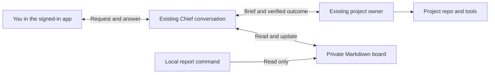

# How Chief works

Chief runs in one existing Codex or Claude Code conversation. The app supplies sign-in, model access, tools and approvals. Tasks and project ownership live in a separate private workspace.

1. You ask Chief for an outcome in the native conversation. Chief reads the relevant card, the project registry and the applicable release rules.
2. For project work, Chief briefs the existing lead through an authorized native tool. The lead checks the result in the project’s own workspace. If a browser is needed, the lead uses its assigned tab and profile.
3. Chief records the result or missing input on the original task card and replies in your conversation. If a handoff was interrupted, Chief checks the card and the owner’s saved result before retrying.

For a board report, Chief reads the saved cards. You can also run the read-only report directly from a shell. Native conversation history stays in the app. The board, including dated decisions and file references, remains readable with ordinary file tools.

[Board commands](core.md#read-the-board) · [Diagram source](architecture.mmd)
