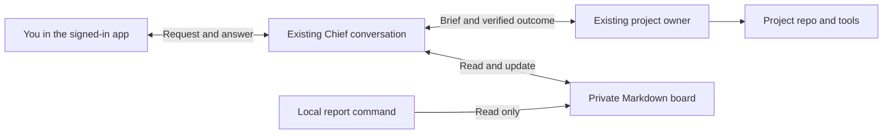

# How Chief works

Chief runs in one existing Codex or Claude Code conversation. The app supplies sign-in, model access, tools and approvals. Tasks and project ownership live in a separate private workspace.

1. You ask Chief for an outcome in the native conversation. Chief reads the relevant card, the project registry and the applicable release rules.
2. For project work, Chief saves the brief, original request and assignment key on the card, then uses an authorized native tool to reach the existing lead. A refused send stays on the card for the lead’s next authorized visit. An uncertain send requires reconciliation before another attempt. The lead checks the result in the project’s own workspace and uses its assigned browser tab and profile when needed.
3. Chief matches the lead’s labelled result to the assignment and accepting turn, saves it on the original card and replies in your conversation. The card records the status and any missing evidence. [Handoff and recovery steps](core.md#native-owner-handoffs)

For a board report, Chief reads the saved cards. You can also run the read-only report directly from a shell. Native conversation history stays in the app. The board, including dated decisions and file references, remains readable with ordinary file tools.

[Board commands](core.md#read-the-board) · [Diagram source](architecture.mmd)
